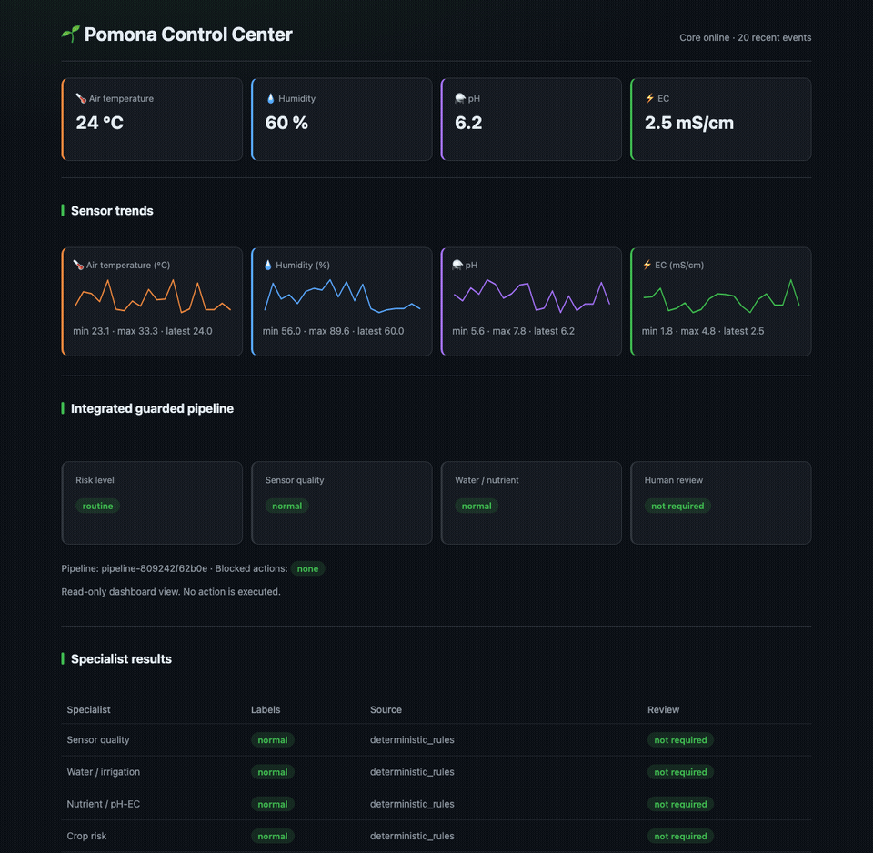

<div align="center">

# 🌱 Pomona

**Open edge AI platform for agriculture** — MQTT ingest, reasoning, deterministic safety checks, and dashboards for greenhouse and hydroponic systems.

<p align="left">Pomona is for researchers, students, and hobby and small growers who want to experiment with greenhouse monitoring. Today it checks whether sensor readings can be believed before it gives advice: step, freeze, noise and drift checks (slow drift of some readings is still not caught), where a failed check vetoes the reading and raises a sensor card. It then gives suggestion-only advice that a person approves or rejects, and nothing is actuated. It ships a fake greenhouse with injected sensor faults, a truth log and a scorer, so you can try all of this with no hardware. It is software only so far: no bench-tested hardware and no field data.</p>

[](LICENSE)
[](VERSION)
[](CONTRIBUTING.md)
[](https://huggingface.co/Okyanus/ai-pomona-agronomist-gemma4)
[](docs/INSTALL.md)

Anyone can clone, use, fork, and contribute — free under [Apache-2.0](LICENSE).

[Website](https://okyanu.github.io/pomona/) · [GitHub](https://github.com/okyanu/pomona) · [Hugging Face](https://huggingface.co/Okyanus) · [Automation API](https://automation-engine-fawn.vercel.app) · [Quickstart](#-quickstart-docker) · [Contribute](#-open-source--contribute)

**[🌱 Try the guarded greenhouse & hydroponic demo in your browser](https://huggingface.co/spaces/Okyanus/pomona-greenhouse-demo)** — no install, no login.

**[🎯 Try to fool Pomona](https://huggingface.co/spaces/Okyanus/try-to-fool-pomona)** — break a sensor in a pretend greenhouse and see if Pomona catches it. No install, no login.



</div>

---

> **Early MVP.** Simulated sensors → SQLite-backed API → guarded reasoner pipeline → monitoring dashboard with manual suggestion decisions. No actuator execution. Docker remains the recommended deployment path; local validation also works without Docker. [What to expect →](docs/GETTING_STARTED.md)

## 🚀 Quickstart (Docker)

```bash
git clone https://github.com/okyanu/pomona.git
cd pomona
cp .env.example .env
./scripts/setup.sh          # optional first-time check
./scripts/up.sh
./scripts/sim.sh            # new terminal
curl http://localhost:8080/health
python3 examples/tomato_risk_quickstart.py   # real sensor JSON -> risk labels
# with the stack up, open the dashboard at http://localhost:3000
```

**Requirements:** [Docker Desktop](https://www.docker.com/products/docker-desktop/)
**Also needed for the simulator and tests:** Python 3.11 on the host (`./scripts/sim.sh`, `make test-local`). The Docker stack alone does not need it.

| Service | URL |
|---------|-----|
| Dashboard | http://localhost:3000 |
| Core API | http://localhost:8080 |
| Model router | http://localhost:8081 |
| MQTT | localhost:1883 (login from `.env`, see [SECURITY.md](SECURITY.md)) |

Docker publishes MQTT, Core and the dashboard on this computer only by default. To let real devices on your
network connect, set `POMONA_BIND_ADDRESS=0.0.0.0` in `.env` (trusted network only; see [SECURITY.md](SECURITY.md)).

Full guide: **[docs/INSTALL.md](docs/INSTALL.md)**
One-command full stack (UI + database in Docker): [docs/PLUG_AND_PLAY.md](docs/PLUG_AND_PLAY.md)
Local validation details: **[docs/LOCAL_VALIDATION.md](docs/LOCAL_VALIDATION.md)**

### Local validation without Docker

When Docker Desktop is unavailable, run the four-service smoke test with the
local Python environments:

```bash
./scripts/run_local_validation.sh
# or
make local-validation
```

Run the complete local service test suite with:

```bash
make test-local
```

Run tests and the full local service smoke test together with:

```bash
make local-check
```

It uses temporary SQLite and audit state, verifies both high-risk and routine
paths, checks the dedicated Safety Checker, and removes temporary processes and
files when it finishes.

## 🏗 Architecture

```text
Sensor / Simulator → MQTT → pomona-core → DB → model-router
   → reasoner / advisor LLM → safety-checker → automation-engine → dashboard
```

**Hard rule:** the LLM advises — it never directly controls actuators. Deterministic rules make every decision, and there is no actuator execution path: automation only raises suggestions for a person to approve or reject. The rules are tested but not field-calibrated.

More detail: **[docs/architecture.md](docs/architecture.md)**

## 📊 Status and roadmap

**Platform `v0.1.0-alpha.1`** · **11 phases** · **2 completed** · **8 active/partial** · **Phase 2 is the primary product focus**

Phases 0 and 1 are done. Phases 2, 3, 4, 5, 6, 7, 9 and 10 are partial: some pieces exist, which does not mean the phase is being worked on now. Phase 8 (ESP32 devices) is still planned: logger firmware compiles; not yet bench-tested, no field data. Phase 2 hardening continues; current focus is sensor-check coverage on real logs, fake-greenhouse scoring and hardware bench testing. The maintainer's plan for the next three months is in **[docs/NEXT_90_DAYS.md](docs/NEXT_90_DAYS.md)**.

The one full phase table is **[docs/PHASES.md](docs/PHASES.md)**. See also [PROJECT_STATUS.md](docs/PROJECT_STATUS.md) · [ROADMAP.md](docs/ROADMAP.md) · [VERSIONING.md](docs/VERSIONING.md)

## 🤝 Open source & contribute

| | |
|---|---|
| **License** | [Apache-2.0](LICENSE) — free to use and modify |
| **Contributing** | [CONTRIBUTING.md](CONTRIBUTING.md) — PRs welcome |
| **Code of conduct** | [CODE_OF_CONDUCT.md](CODE_OF_CONDUCT.md) |
| **Current work** | [docs/PROJECT_STATUS.md](docs/PROJECT_STATUS.md) |
| **Roadmap** | [docs/ROADMAP.md](docs/ROADMAP.md) |
| **Website** | [Project documentation →](https://okyanu.github.io/pomona/) |

**Good first contributions:** tests, docs, simulators, crop templates, dashboard polish.

Fork → branch → `make test-local` → open PR. Environment setup is in [CONTRIBUTING.md](CONTRIBUTING.md).

## 🔗 Related open repos

| Repo | Purpose |
|------|---------|
| **[Pomona website](https://okyanu.github.io/pomona/)** | Main documentation, architecture, roadmap, and guides |
| **[pomona](https://github.com/okyanu/pomona)** (this) | Platform — run with Docker |
| **[Automation API](https://automation-engine-fawn.vercel.app)** | Live suggestion-only automation service and API documentation |
| **[Okyanus on Hugging Face](https://huggingface.co/Okyanus)** | Models, datasets, collection, and browser demo |
| `pomona-agronomist-llm` (not yet published) | Agronomist ML training |
| [HF Collection](https://huggingface.co/collections/Okyanus/pomona-local-ai-for-safer-greenhouse-decision-support-6a89931ffcc2f7a3f777f3b9) | All published models + dataset in one place |
| [HF agronomist](https://huggingface.co/Okyanus/ai-pomona-agronomist-gemma4) | Advisor LoRA weights |
| [HF tomato reasoner](https://huggingface.co/Okyanus/pomona-tomato-risk-reasoner-v0.1.7-lora) | Tomato risk-label LoRA (v0.1.7) |
| [HF water/irrigation reasoner](https://huggingface.co/Okyanus/pomona-water-irrigation-risk-reasoner-v0.1.8-lora) | Moisture-risk LoRA release candidate (v0.1.8) |
| [HF actuator command gate](https://huggingface.co/Okyanus/pomona-actuator-command-gate-reasoner-v0.1-lora) | Advisory research preview; deterministic gate remains final |
| [HF greenhouse sensor dataset](https://huggingface.co/datasets/Okyanus/greenhouse-sensor-data) | Published greenhouse sensor dataset |

Model catalog and release status: **[docs/MODEL_CATALOG.md](docs/MODEL_CATALOG.md)**

## 🧠 Model status

Pomona keeps platform code, routing, deterministic safety logic, and metadata in GitHub. Model weights and published datasets live on Hugging Face.

| Model | Current status | Use now? |
|-------|----------------|----------|
| Tomato risk reasoner `v0.1.7` | Published on Hugging Face, experimental: learned a training shortcut and answers `[]` on 146 of 153 varied benchmark cases ([details](docs/TOMATO_RISK_REASONER.md#evaluation-snapshot)) | ⚠️ Research only; the guarded route uses deterministic rules |
| Water/irrigation reasoner `v0.1.8` | Published release candidate; evaluated only on synthetic, rule-derived cases | ⚠️ Advisory only, behind deterministic validation |
| Sensor quality reasoner `v0.1.1-boundary` | Local candidate, not published | ⚠️ Owner's local integration tests only; not available publicly |
| Safety triage reasoner `v0.1` | Local candidate, failed its publish gate; not published | ⚠️ Owner's local integration tests only; not available publicly |
| Actuator command gate `v0.1` | Published research preview, below standalone release gate | ⚠️ Advisory only; deterministic checker required |
| Actuator command gate `v0.1.1-hardcases` | Regression in local eval | ❌ Do not use |
| Actuator command gate `v0.1.2-correction` | Regression on a held-out (mostly generated) eval | ❌ Do not use |
| Nutrient / pH-EC reasoner `v0.1.1-correction` | LoRA, GGUF, and MLX published; evaluated only on synthetic, rule-generated cases | ⚠️ Only through the deterministic guarded route; the rules make the decision |

Near-term integration chain:

```text
sensor-quality
  -> tomato-risk
  -> safety-triage
  -> deterministic actuator-command gate
  -> dashboard / human approval
```

Future model families are tracked in [docs/ROADMAP.md](docs/ROADMAP.md) and [docs/SMALL_MODEL_FACTORY.md](docs/SMALL_MODEL_FACTORY.md).

## 📄 License

Copyright 2026 Pomona Contributors. Licensed under [Apache-2.0](LICENSE).
